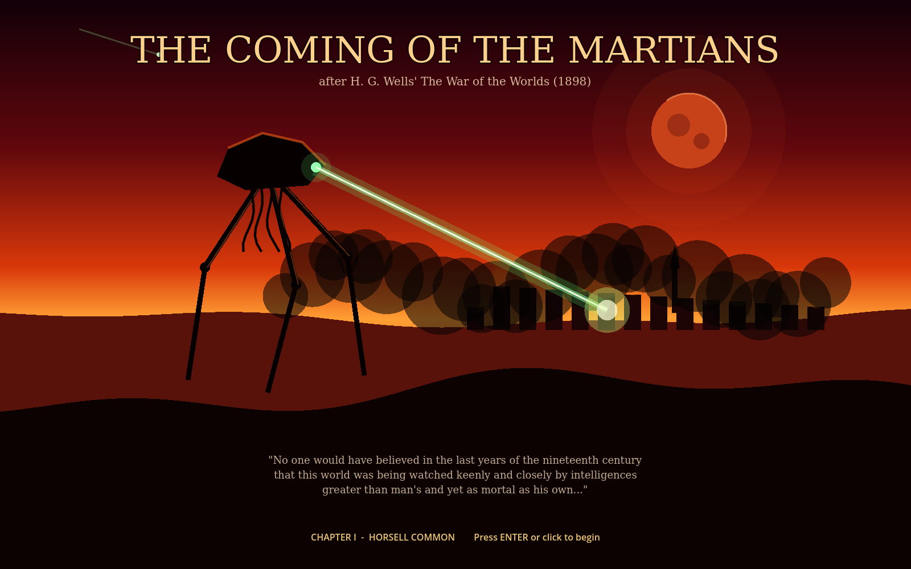

# The Coming of the Martians

A small-squad real-time strategy prototype based on H. G. Wells' *The War of the Worlds* (1898). Built in **Godot 4.3** with GDScript. Everything is drawn in code, so there are no art assets yet.




## Running it

1. Install [Godot 4.3](https://godotengine.org/download) (the standard build, not .NET).
2. Open Godot, click **Import**, and select `project.godot` in this folder.
3. Press **F5** to play.

## Chapter I: Horsell Common

A fighting-machine has risen from the pit. You command:

- **Sgt. Tolliver's gun**: one horse-drawn field gun and its crew. It is the only thing that can hurt the machine, and every shot gives away its position.
- **Three named survivors**: Ellen Ashby (schoolteacher), Walter Hale (telegraph clerk) and Joseph Marsh (innkeeper, 61, slow). They cannot fight. They run, hide in cellars, and try to escape.

**Goal:** get at least one survivor across the river to the Leatherhead road (the dashed box, bottom left).

### Controls

| Input | Action |
|---|---|
| Left-click / drag | Select units |
| Right-click | Move |
| Right-click a cellar hatch | Hide there |
| H | Hide the selected survivors in the nearest cellar |
| D | Unlimber (deploy) or limber the gun. Deploying takes 2.5 s. |
| Right-click, gun ready | Fire (range shown as a circle) |
| 1-4 / A | Select one unit / all units |
| Space | Pause |
| R | Restart |
| F1 | Show or hide the orders panel |

### How the machine behaves

- **It sees.** The faint green cone is its field of view. Buildings block sight, and woods cut its sight range to about 110 px. The `!` ring on a unit shows how close it is to being spotted. Once the ring fills, the heat-ray charges for 1.3 s. Break line of sight before then.
- **It hears.** Every gunshot draws it to the gun's position.
- **It smokes out hiders.** If it saw someone dive into a cellar, or is searching near one, it fires a canister of **black smoke**. Smoke sinks, so a cellar is twice as deadly as open ground. Get out.
- **Its shield.** Shells burst harmlessly on the shield. Two hits overload it for 7 s, and only then can a shell damage the hull. Three hull hits bring the machine down. The gun reloads in 4 s, and the machine's sight range (340) is shorter than the gun's range (640). The way to win is to fire from long range, then limber and move.
- **The sickness (the ending mechanic).** Earth's bacteria are slowly killing the Martian inside. As it sickens, the machine slows down and its shield **flickers**, which opens windows to fire. If it dies of sickness, everyone still alive wins. In this prototype the sickness is sped up to 5 minutes so you can see it. In the full campaign it builds across the whole war and becomes the finale, when every machine's shield fails.

## Art direction

The mood is a 1970s painted prog-rock album cover: blood-red skies, burning orange, sickly heat-ray green, black smoke, and silhouettes against fire. A full-screen grading shader (`shaders/grade.gdshader`) adds the warm duotone, vignette and grain.

**Legal note:** *The War of the Worlds* novel is in the public domain. *Jeff Wayne's Musical Version* is not. Its machine designs, album artwork, music, sound effects and narration are owned by Jeff Wayne Music Group. Do not copy them, even renamed. The fighting-machine here is our own design, built from Wells' text: a cowled body, three jointed legs, hanging metal tentacles, a single green lens and a heat-ray projector arm. The shield is also our own mechanic. Keep it that way, or license the musical properly.

## Project layout

```
project.godot
scenes/main.tscn          entry scene (just hosts main.gd)
scripts/main.gd           mission setup, input, combat resolution, win/lose, automated tests
scripts/world.gd          map, buildings, cellars, woods, river, fires, A* pathfinding, line of sight
scripts/unit.gd           base class for player units
scripts/survivor.gd       named civilians: run, hide, choke
scripts/field_gun.gd      limber/unlimber/fire/reload state machine
scripts/tripod.gd         the fighting-machine: perception, AI states, shield, sickness, legs
scripts/projectile.gd     shells and smoke canisters
scripts/black_smoke.gd    the poison cloud
scripts/blast.gd          impact flashes
scripts/hud.gd            HUD and command strip
scripts/title.gd          painted title card
shaders/grade.gdshader    colour grade
```

## Automated playtests

Several scripted scenarios run headless and print a log and summary:

```bash
godot --headless --fixed-fps 60 -- --autotest=a   # survivors run, gun gets caught
godot --headless --fixed-fps 60 -- --autotest=b   # everyone hides, gun fights
godot --headless --fixed-fps 60 -- --autotest=c   # do nothing; sickness ending
godot --headless --fixed-fps 60 -- --autotest=d   # shield overload, kills, black smoke
```

To save screenshots, add `--shots=/abs/path --shot-times=3,14` (this needs a display, or `xvfb-run`).

## Roadmap

1. **Map of England campaign screen.** A painted map from Woking to London and the coast. You choose routes between chapters, and named survivors (and their injuries) carry over.
2. **More chapters from the novel:** Weybridge and Shepperton (the guns at the river), the black smoke over London, the *Thunder Child* covering the steamers, the red weed, and the silent machines of Primrose Hill.
3. **Finale:** the sickness peaks and every machine's shield fails at once. The last stand turns into a counter-attack.
4. **Survivor traits and morale.** Panic, injuries, and characters who can refuse orders.
5. **Real art and audio:** painted backgrounds, a 3D or sprite fighting-machine, and an original score.
6. **Camera and bigger maps:** panning, zoom and fog of war.
