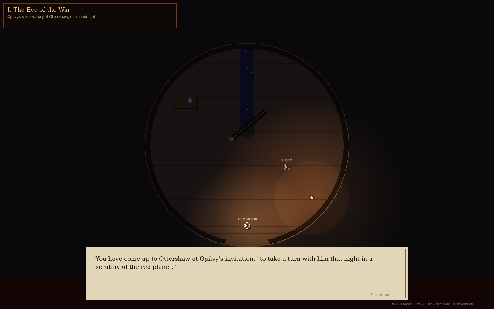
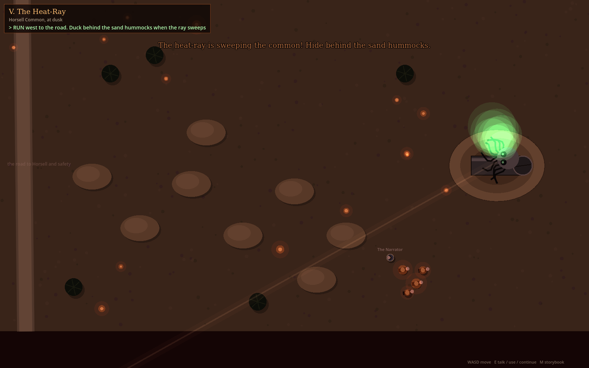
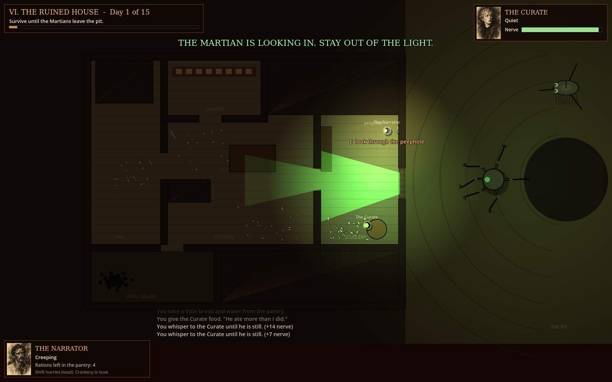
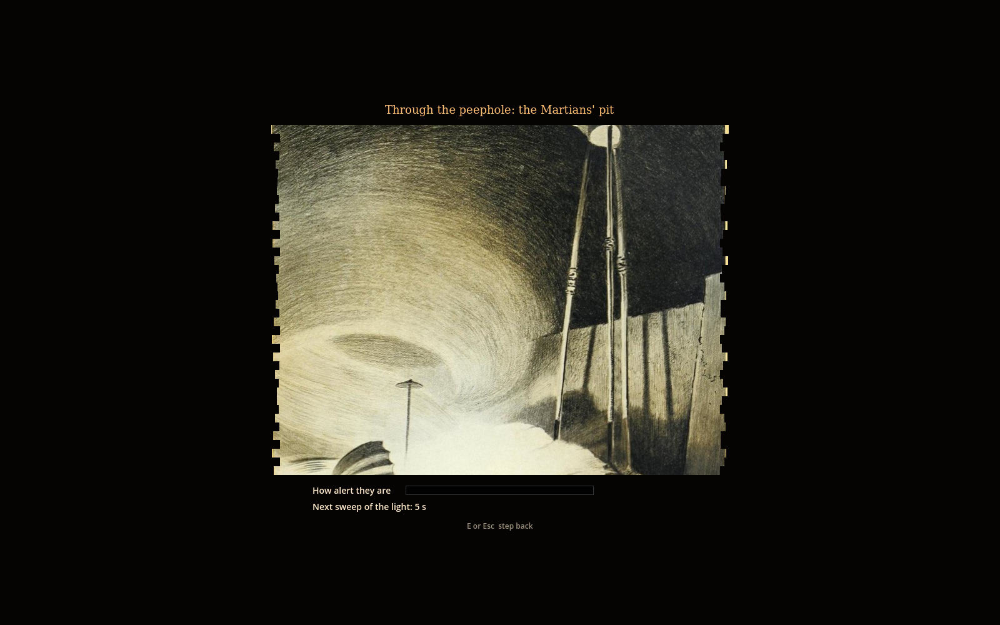
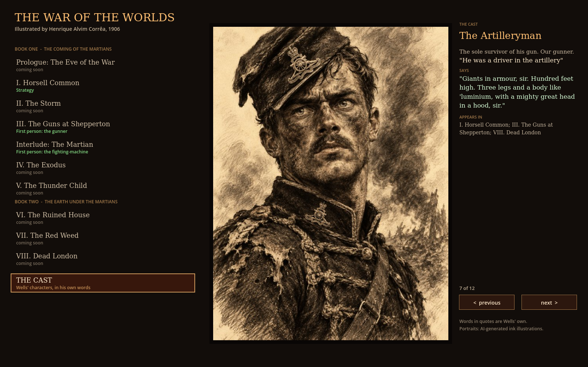
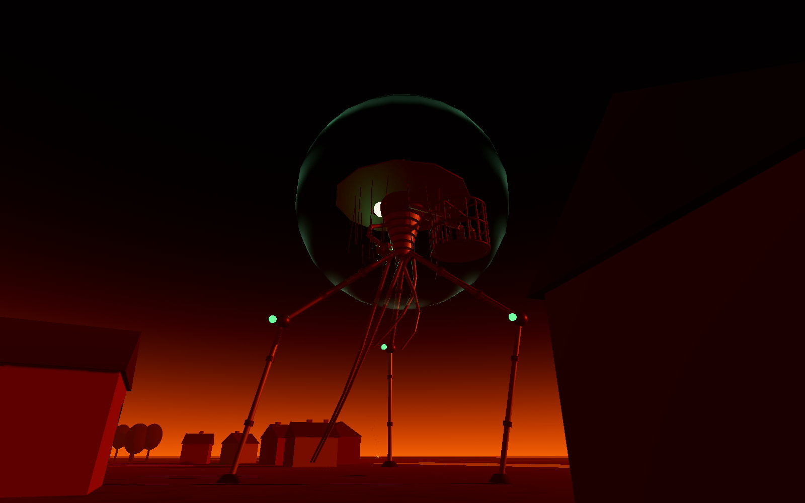

# The Coming of the Martians

A game based on H. G. Wells' *The War of the Worlds* (1898). Built in **Godot 4.3** with GDScript. Everything is built in code, so there are no art assets yet.


## Running it

1. Install [Godot 4.3](https://godotengine.org/download) (the standard build, not .NET).
2. Open Godot, click **Import**, and select `project.godot`.
3. Press **F5**. The main menu offers the story and three modes.

In every mode, **R** restarts and **M** returns to the menu.

## The story: play the novel, chapter by chapter


Choose **THE STORY** on the main menu. The game follows the novel's own chapters in order, from the observatory at Ottershaw to Dead London, illustrated with Henrique Alvim Corrêa's 31 plates from the 1906 edition (public domain; see `art/correa/CREDITS.md`). Read each chapter's pages, then press **Play**. When you finish a chapter, the story moves on to the next one, and your place is saved.

| Book One | How you play it |
|---|---|
| I. The Eve of the War | Story: the observatory. Look through Ogilvy's telescope and catch the flash on Mars. |
| II. The Falling Star | Story: play as Ogilvy. Find the cylinder at dawn and fetch Henderson. |
| III. On Horsell Common | Story: the crowd at the pit. Stop the boys, and run Ogilvy's errand. |
| IV. The Cylinder Opens | Story: the lid falls and the Martian emerges. Run for the trees. |
| V. The Heat-Ray | Story: the Deputation burns. Flee across the common, ducking behind hummocks as the ray sweeps. |
| VI. The Heat-Ray in the Chobham Road | Read |
| VII. How I Reached Home | Story: nobody in Maybury believes you, then dinner with your wife |
| VIII. Friday Night | Read |
| IX. The Fighting Begins | Strategy: the dog cart road to Leatherhead |
| X. In the Storm | Story: the third star falls, the dog cart crashes, then cross the storm. In each lightning flash, be in cover or be seen. |
| XI. At the Window | Story: watch Woking burn, let the artilleryman in, and hear his story |
| XII. The Destruction of Weybridge and Shepperton | First person: the artilleryman's gun |
| Interlude: The Martian | First person: the fighting-machine |
| XIII to XVII (the curate, London, the Exodus, the *Thunder Child*) | Read (playable soon) |

| Book Two | How you play it |
|---|---|
| I-VI. The Ruined House | Stealth: fifteen days beside the pit |
| VII. The Man on Putney Hill, VIII. Dead London, IX-X. Wreckage; The Epilogue | Read (playable soon) |




### The story engine

The quieter chapters run on a walk-and-talk engine (`scripts/story/`). Each chapter is a data script in `scripts/story/chapters/`: its map, its characters, and a list of steps, each with a goal, a condition (talk to someone, use something, reach a place) and the actions that follow (dialogue, narration, Corrêa plate cutscenes, the telescope, moving characters, fire, the heat-ray). Writing a new chapter means writing one of these files. All dialogue is Wells' own, spoken by the characters who say it in the novel, and is checked by `tools/check_quotes.py`.

Controls: WASD to move, E to talk, use or continue, M for the storybook.

## VI. The Ruined House (stealth)



Book Two, chapters I to V. The fifth cylinder has buried the house where the Narrator shelters with the Curate, right beside the Martians' pit. Survive fifteen days, which are compressed to 20 seconds each (about five minutes in total).

- **Keep quiet.** Shift hurries but is loud, and the white shards of crockery are loud underfoot ("You can't possibly move without making a noise"). Noise draws a tentacle in through the hole.
- **Stay out of the green light.** When the light turns toward the house, anyone standing in it is seen.
- **Keep the Curate sane.** His nerve drains, faster after the Martians feed (day 3 and day 9). Bring him food from the pantry (E) and hold E beside him to calm him. If he breaks, he preaches, then heads for the hole shouting Wells' own lines. Stop him as the narrator did, with the butt of the meat chopper (F).
- **The coal cellar.** Bury yourself in the coal (E). If the tentacle touches your boot, don't move.
- **The peephole** shows Corrêa's plates of the pit, plus how alert the Martians are and when the light will next sweep.
- **Day 15:** the pit is empty. Climb out through the hole. If the Curate is still with you, you get an ending Wells never gave him.



## The cast: Wells' characters



The game follows the novel's own people. Each character has an ink portrait drawn from Wells' description (AI-generated; see `art/portraits/CREDITS.md`), and their descriptions and spoken lines are Wells' words, defined in `scripts/cast.gd`.

- **Storybook:** each chapter shows who appears in it (click a portrait), and **THE CAST** page has every character's portrait, description and line.
- **Chapter I:** you escort **the Narrator, his Wife and the Landlord** of the Spotted Dog down the dog cart road to Leatherhead, as in the novel, covered by **the Artilleryman's** gun. Their portraits are on the unit cards, and each speaks their line the first time the machine nearly spots them.
- **The Artillery:** you play **the Artilleryman**, who opens with his report from the novel: "Gun destroyed last night, sir. Have been hiding. Trying to rejoin battery, sir."

Every quote in the game can be re-checked against the novel:

```bash
python3 tools/check_quotes.py
```

## The fighting-machine and its cage



The machines are styled after **Henrique Alvim Corrêa's 1906 plates**, which are public domain. Each has a wide conical hat with a spike on top, two great round eyes under the brim, a ribbed screw-like body, needle-thin stilt legs with ringed joints, a curtain of hair-thin filaments, ribbed tentacles, and a camera-like heat-ray box held out on an arm. On its back hangs the **cage**. Wells describes the Martian throwing captives into *"a great metallic carrier which projected behind him, much as a workman's basket hangs over his shoulder."* Machines seize people with their tentacles and the cage fills up. Bring a machine down and the people in its cage go free.

To see the 3D machine up close, run the dev scene `scenes/dev/machine_showcase.tscn`.

Shared rules:

- **Shield:** shells burst harmlessly on it. Two quick hits overload it for a few seconds, and only then does a shell damage the hull. Three hull hits bring the machine down.
- **Black smoke:** a poison cloud. In the RTS, a cellar is twice as deadly as open ground, because smoke sinks.
- **The sickness (the finale mechanic):** Earth's bacteria are slowly killing the Martians. Machines slow down and their shields flicker, which opens windows to fire. Eventually they collapse. In the full campaign this builds across the whole war until every shield fails at once.

---

## 1. Chapter I: Horsell Common (strategy)


Command Sgt. Tolliver's field gun and three named survivors: Ellen Ashby, Walter Hale and Joseph Marsh. Get at least one survivor across the river to the Leatherhead road. If the machine catches anyone close enough, it seizes them and throws them into its cage. Shoot it down to free them.

| Input | Action |
|---|---|
| Left-click / drag | Select units |
| Right-click | Move, or fire when the gun is ready |
| Right-click a cellar hatch / H | Hide |
| D | Unlimber or limber the gun |
| 1-4 / A | Select one unit / all units |
| Space | Pause |
| F1 | Show or hide the orders panel |

## 2. The Fighting-Machine (first person, you are the Martian)


You stand 28 m tall over the village. Five artillery batteries are shelling you. Silence them with the heat-ray or black smoke, and fill the cage on your back. But the air of Earth is poisoning you: when the *EARTH'S AIR* bar fills, you die. Firing drains the heat-ray, so you have to let it recharge.

| Input | Action |
|---|---|
| Mouse | Look and steer |
| W A S D | Walk. Hold Shift to stride faster. |
| Hold left mouse button | Heat-ray |
| Right-click / E | Seize a nearby human with your tentacles |
| F | Fire a black-smoke canister |
| V | Switch between first and third person (to see your machine and cage) |
| Esc | Pause |

## 3. The Artillery (first person, you are a gunner)


Your crews are dead. A fighting-machine stalks the village with two people already in its cage, and it snatches more as it goes. Sneak between the three abandoned guns and bring it down.

- **The eye** at the top of the screen shows how close the machine is to seeing you. When it fills, the heat-ray charges for 2 seconds. Break line of sight or die.
- Crouching (C) and buildings keep you hidden. Sprinting makes you easier to spot. Every shot you fire draws the machine to that gun.
- The gun's shield plate hides you better: the machine can only spot a manned gun within 160 m. Fire from long range, then move to another gun.
- When you're at a gun, a glowing line shows where the shell will fall. It reads **ON TARGET** when the shell will hit the machine.

| Input | Action |
|---|---|
| Mouse / W A S D | Look / move. Shift sprints, Space jumps. |
| C | Crouch |
| E | Take or leave a gun |
| Mouse (at a gun) | Traverse and elevate the gun |
| Left-click (at a gun) | Fire (4 s reload) |
| Esc | Pause |

---

## Sound and music

**Music:** every chapter has its own piece from the **Musopen Kickstarter recordings** by the Czech National Symphony Orchestra. Musopen released these recordings into the public domain. Some examples:

- The observatory in Chapter I opens to Mendelssohn's misty *Scottish* Andante.
- The cylinder opens to the dark first bars of Tchaikovsky's *Pathétique*.
- The storm in Chapter X plays under the pounding timpani of Brahms' First.
- The Ruined House plays under the *Pathétique*'s "Adagio lamentoso".
- Dead London plays under "Åse's Death".
- The epilogue plays under Grieg's "Morning".

`audio/CREDITS.md` lists every piece and where it plays. `tools/fetch_music.py` downloads the recordings from archive.org and cuts the looping excerpts.

**Sound effects:** `tools/gen_sfx.py` synthesises all of them from scratch with numpy, with no samples. They include:

- the Martians' "Ulla" howl
- the Heat-Ray's whine
- the stride and clank of the machines
- the cylinder unscrewing
- field guns, shells, thunder, rain and crowds
- a heartbeat when the tentacle comes close

**Code:** `scripts/sound.gd` (`Sound.play`, `Sound.loop`, `Sound.music`) is a static class, so no autoload is needed. The main menu has **Music** and **Effects** volume sliders, which are saved to `user://settings.json`.

## Art direction

The mood is a 1970s painted prog-rock album cover: blood-red skies, burning orange, sickly heat-ray green, black smoke, and silhouettes against fire.

**Legal note:** *The War of the Worlds* novel is in the public domain. *Jeff Wayne's Musical Version* is not. Its machine designs, artwork, music, sound effects and narration belong to Jeff Wayne Music Group. Do not copy them, even renamed. Our machines follow Alvim Corrêa's public-domain 1906 designs, the cage comes from Wells' text, and the shield mechanic is our own. Keep it that way, or license the musical.

## Project layout

```
scenes/menu.tscn            main menu (start scene)
scenes/campaign.tscn        the storybook: chapter select (scripts/campaign.gd); chapters in scripts/story.gd
scenes/story_scene.tscn     the walk-and-talk story engine (scripts/story/)
scripts/sound.gd            Sound: effects, ambience loops, music and volumes (+ sound_host.gd)
audio/music/, audio/sfx/    Musopen recordings (public domain) and synthesised effects; see audio/CREDITS.md
tools/gen_sfx.py            synthesises audio/sfx/*.ogg
tools/fetch_music.py        downloads and cuts audio/music/*.ogg
scripts/campaign_state.gd   CampaignState: campaign progress and save (user://campaign.json); no autoload needed
art/correa/                 the 1906 plates (public domain) and CREDITS.md
art/portraits/              character portraits and CREDITS.md
scripts/cast.gd             the characters: Wells' descriptions and lines
tools/check_quotes.py       checks every quote against the-war-of-the-worlds.txt
scenes/main.tscn            Chapter I (strategy)
scenes/pilot.tscn           The Fighting-Machine (first person)
scenes/soldier.tscn         The Artillery (first person)

scripts/menu.gd             painted main menu
scripts/main.gd             RTS mission, input, combat, tests
scripts/world.gd            RTS map, pathfinding, line of sight
scripts/tripod.gd           RTS machine: AI, shield, sickness, tentacles, cage
scripts/unit.gd, survivor.gd, field_gun.gd, projectile.gd, black_smoke.gd, blast.gd, hud.gd

scripts/fp/tripod3d.gd      3D machine model: legs, tentacles, cage, heat-ray, shield
scripts/fp/countryside3d.gd 3D world: sky, fog, village, woods, river, pit, fires
scripts/fp/pilot_mode.gd    pilot mode (+ pilot_hud.gd)
scripts/fp/soldier_mode.gd  soldier mode and the machine's AI (+ soldier_hud.gd)
scripts/fp/gun3d.gd, shell3d.gd, person3d.gd, fire3d.gd, smoke3d.gd, explosion3d.gd
scripts/house/               VI. The Ruined House: house_mode.gd, house_map.gd, tentacle.gd, house_hud.gd

shaders/grade.gdshader      RTS colour grade
shaders/shield.gdshader     3D shield shimmer
```

## Automated playtests

These run headless and print a log and summary:

```bash
godot --headless --fixed-fps 60 res://scenes/main.tscn -- --autotest=a     # RTS: survivors run (variants a-e)
godot --headless --fixed-fps 60 res://scenes/main.tscn -- --autotest=e     # RTS: capture into the cage, then rescue
godot --headless --fixed-fps 60 res://scenes/pilot.tscn -- --autotest      # pilot mode
godot --headless --fixed-fps 60 res://scenes/soldier.tscn -- --autotest    # soldier mode: a test gunner duels the machine
godot --headless --fixed-fps 30 res://scenes/story_scene.tscn -- --story=b1_01 --autotest   # any story chapter (b1_01 ... b1_11)
godot --headless --fixed-fps 60 res://scenes/ruined_house.tscn -- --autotest=wells   # the house, as in the novel (also: --autotest, --autotest=caught)
```

To save screenshots, add `--shots=/abs/path --shot-times=3,7` (this needs a display, or `xvfb-run`).

## Roadmap

1. **Map of England campaign:** choose routes from Woking to London between chapters. Named survivors carry over, and whether a gun crew lives or dies changes later chapters.
2. **More chapters:** Weybridge and Shepperton, the black smoke over London, the *Thunder Child*, the red weed, and Primrose Hill. Each can be played in the mode that suits it.
3. **Finale:** the sickness peaks and every shield fails at once.
4. **Real art:** a modelled fighting-machine and painted skies. LibriVox's public-domain readings of the novel could voice the narration.
5. **First-person polish:** a body and hands for the gunner, horses and limbers, and more guns and crews.
