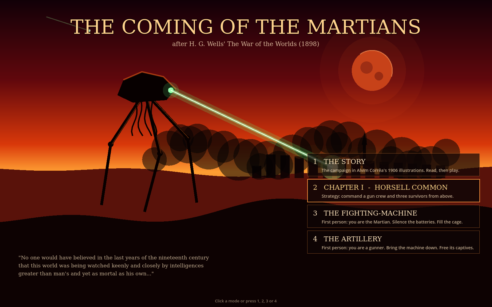
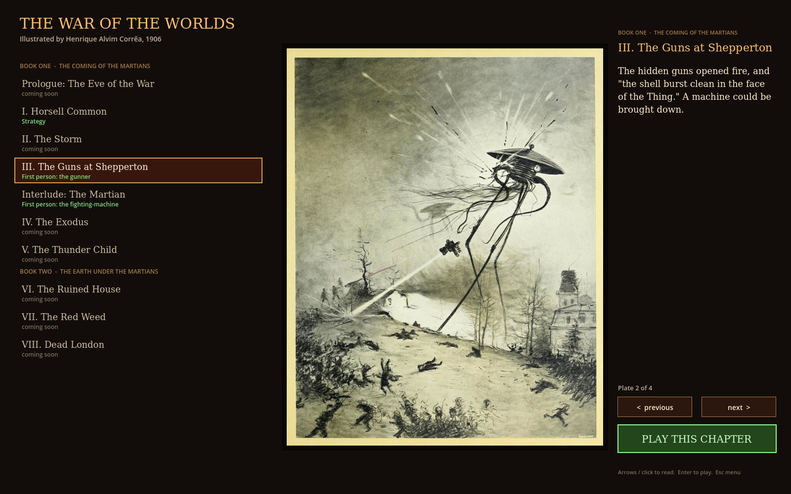
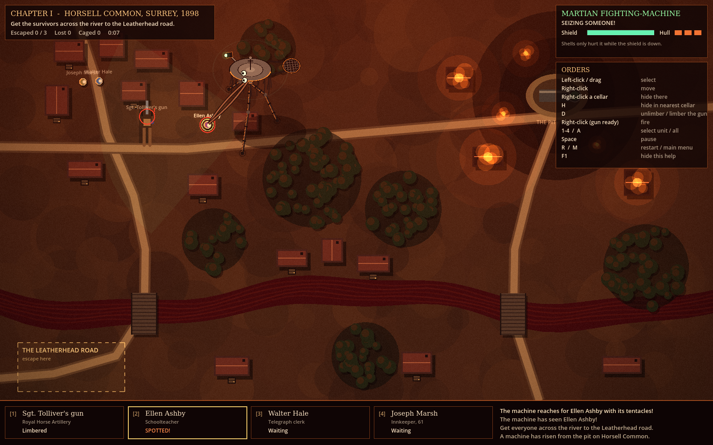
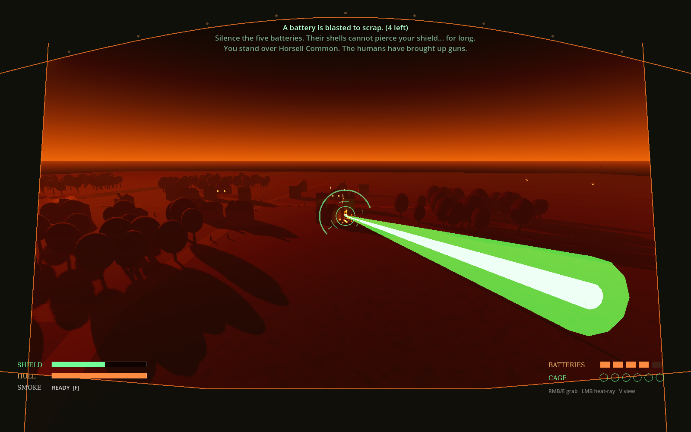
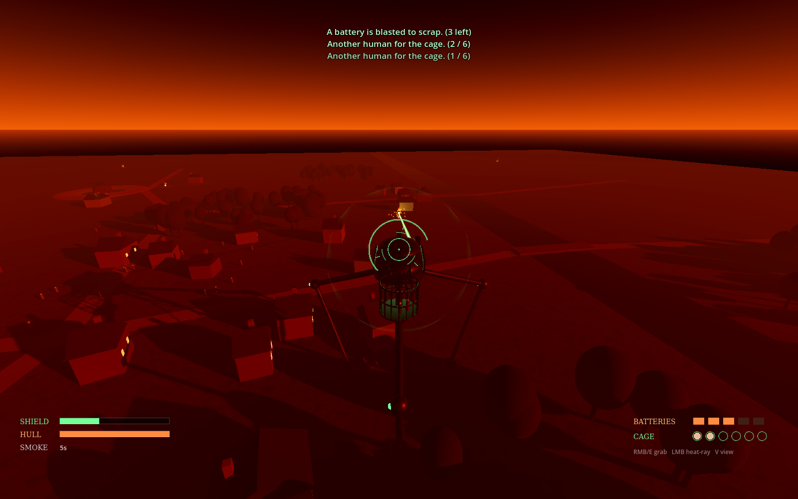
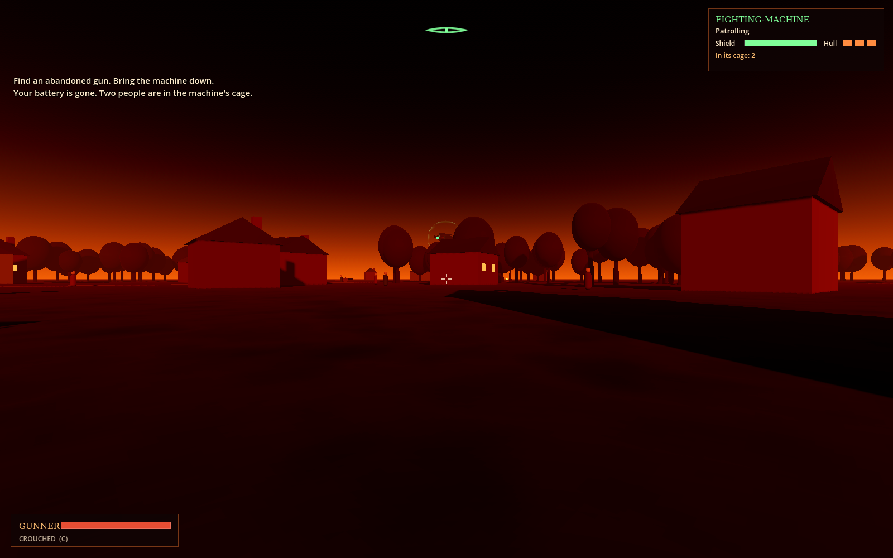
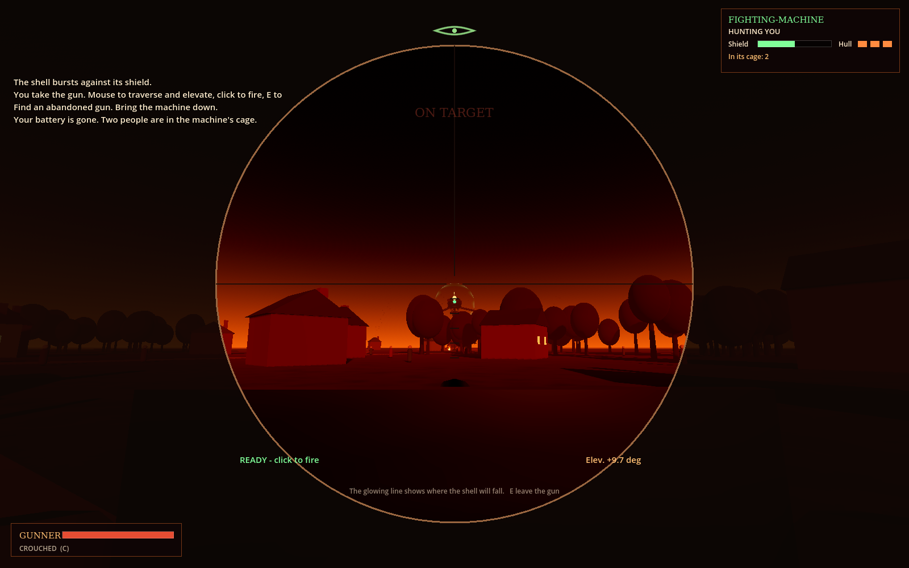

# The Coming of the Martians

A game based on H. G. Wells' *The War of the Worlds* (1898). Built in **Godot 4.3** with GDScript. Everything is built in code, so there are no art assets yet.



## Running it

1. Install [Godot 4.3](https://godotengine.org/download) (the standard build, not .NET).
2. Open Godot, click **Import**, and select `project.godot`.
3. Press **F5**. The main menu offers the story and three modes.

In every mode, **R** restarts and **M** returns to the menu.

## The story: Alvim Corrêa's 1906 illustrations



Choose **THE STORY** on the main menu. The campaign is told through Henrique Alvim Corrêa's 31 plates for the 1906 Belgian edition of the novel. They're public domain worldwide; see `art/correa/CREDITS.md`. Each chapter is a run of plates with narration, and text in quotation marks is Wells' own. Read a chapter, then press **Play** if it's built:

| Chapter | Playable as |
|---|---|
| Prologue: The Eve of the War | story only |
| I. Horsell Common | Strategy |
| II. The Storm | coming soon |
| III. The Guns at Shepperton | First person: the gunner |
| Interlude: The Martian | First person: the fighting-machine |
| IV. The Exodus, V. The *Thunder Child* | coming soon |
| VI. The Ruined House, VII. The Red Weed, VIII. Dead London | coming soon |

Controls: arrow keys or click to turn plates, Enter to play, Esc for the menu.

## The fighting-machine and its cage

Every machine is our own design, built from Wells' text: a hooded body on three jointed legs, hanging metal tentacles, a single green lens, a heat-ray projector arm, and the **cage on its back**. Wells describes the Martian throwing captives into *"a great metallic carrier which projected behind him, much as a workman's basket hangs over his shoulder."* In all three modes the machines seize people with their tentacles and the cage fills up. Bring a machine down and the people in its cage go free.

Shared rules:

- **Shield:** shells burst harmlessly on it. Two quick hits overload it for a few seconds, and only then does a shell damage the hull. Three hull hits bring the machine down.
- **Black smoke:** a poison cloud. In the RTS, a cellar is twice as deadly as open ground, because smoke sinks.
- **The sickness (the finale mechanic):** Earth's bacteria are slowly killing the Martians. Machines slow down and their shields flicker, which opens windows to fire. Eventually they collapse. In the full campaign this builds across the whole war until every shield fails at once.

---

## 1. Chapter I: Horsell Common (strategy)



Command Sgt. Tolliver's field gun and three named survivors: Ellen Ashby, Walter Hale and Joseph Marsh. Get at least one survivor across the river to the Leatherhead road. If the machine catches anyone close enough, it seizes them and throws them into its cage. Shoot it down to free them.

| Input | Action |
|---|---|
| Left-click / drag | Select units |
| Right-click | Move, or fire when the gun is ready |
| Right-click a cellar hatch / H | Hide |
| D | Unlimber or limber the gun |
| 1-4 / A | Select one unit / all units |
| Space | Pause |
| F1 | Show or hide the orders panel |

## 2. The Fighting-Machine (first person, you are the Martian)




You stand 28 m tall over the village. Five artillery batteries are shelling you. Silence them with the heat-ray or black smoke, and fill the cage on your back. But the air of Earth is poisoning you: when the *EARTH'S AIR* bar fills, you die. Firing drains the heat-ray, so you have to let it recharge.

| Input | Action |
|---|---|
| Mouse | Look and steer |
| W A S D | Walk. Hold Shift to stride faster. |
| Hold left mouse button | Heat-ray |
| Right-click / E | Seize a nearby human with your tentacles |
| F | Fire a black-smoke canister |
| V | Switch between first and third person (to see your machine and cage) |
| Esc | Pause |

## 3. The Artillery (first person, you are a gunner)




Your crews are dead. A fighting-machine stalks the village with two people already in its cage, and it snatches more as it goes. Sneak between the three abandoned guns and bring it down.

- **The eye** at the top of the screen shows how close the machine is to seeing you. When it fills, the heat-ray charges for 2 seconds. Break line of sight or die.
- Crouching (C) and buildings keep you hidden. Sprinting makes you easier to spot. Every shot you fire draws the machine to that gun.
- The gun's shield plate hides you better: the machine can only spot a manned gun within 160 m. Fire from long range, then move to another gun.
- When you're at a gun, a glowing line shows where the shell will fall. It reads **ON TARGET** when the shell will hit the machine.

| Input | Action |
|---|---|
| Mouse / W A S D | Look / move. Shift sprints, Space jumps. |
| C | Crouch |
| E | Take or leave a gun |
| Mouse (at a gun) | Traverse and elevate the gun |
| Left-click (at a gun) | Fire (4 s reload) |
| Esc | Pause |

---

## Art direction

The mood is a 1970s painted prog-rock album cover: blood-red skies, burning orange, sickly heat-ray green, black smoke, and silhouettes against fire.

**Legal note:** *The War of the Worlds* novel is in the public domain. *Jeff Wayne's Musical Version* is not. Its machine designs, artwork, music, sound effects and narration belong to Jeff Wayne Music Group. Do not copy them, even renamed. Our machines, the shield mechanic and the cage design are our own, and the cage comes from Wells' text. Keep it that way, or license the musical.

## Project layout

```
scenes/menu.tscn            main menu (start scene)
scenes/campaign.tscn        the story: Corrêa plates and chapter select (scripts/campaign.gd, scripts/story.gd)
art/correa/                 the 1906 plates (public domain) and CREDITS.md
scenes/main.tscn            Chapter I (strategy)
scenes/pilot.tscn           The Fighting-Machine (first person)
scenes/soldier.tscn         The Artillery (first person)

scripts/menu.gd             painted main menu
scripts/main.gd             RTS mission, input, combat, tests
scripts/world.gd            RTS map, pathfinding, line of sight
scripts/tripod.gd           RTS machine: AI, shield, sickness, tentacles, cage
scripts/unit.gd, survivor.gd, field_gun.gd, projectile.gd, black_smoke.gd, blast.gd, hud.gd

scripts/fp/tripod3d.gd      3D machine model: legs, tentacles, cage, heat-ray, shield
scripts/fp/countryside3d.gd 3D world: sky, fog, village, woods, river, pit, fires
scripts/fp/pilot_mode.gd    pilot mode (+ pilot_hud.gd)
scripts/fp/soldier_mode.gd  soldier mode and the machine's AI (+ soldier_hud.gd)
scripts/fp/gun3d.gd, shell3d.gd, person3d.gd, fire3d.gd, smoke3d.gd, explosion3d.gd

shaders/grade.gdshader      RTS colour grade
shaders/shield.gdshader     3D shield shimmer
```

## Automated playtests

These run headless and print a log and summary:

```bash
godot --headless --fixed-fps 60 res://scenes/main.tscn -- --autotest=a     # RTS: survivors run (variants a-e)
godot --headless --fixed-fps 60 res://scenes/main.tscn -- --autotest=e     # RTS: capture into the cage, then rescue
godot --headless --fixed-fps 60 res://scenes/pilot.tscn -- --autotest      # pilot mode
godot --headless --fixed-fps 60 res://scenes/soldier.tscn -- --autotest    # soldier mode: a test gunner duels the machine
```

To save screenshots, add `--shots=/abs/path --shot-times=3,7` (this needs a display, or `xvfb-run`).

## Roadmap

1. **Map of England campaign:** choose routes from Woking to London between chapters. Named survivors carry over, and whether a gun crew lives or dies changes later chapters.
2. **More chapters:** Weybridge and Shepperton, the black smoke over London, the *Thunder Child*, the red weed, and Primrose Hill. Each can be played in the mode that suits it.
3. **Finale:** the sickness peaks and every shield fails at once.
4. **Real art and audio:** a modelled fighting-machine, painted skies and an original score.
5. **First-person polish:** a body and hands for the gunner, horses and limbers, more guns and crews, and sound cues for the machine.
